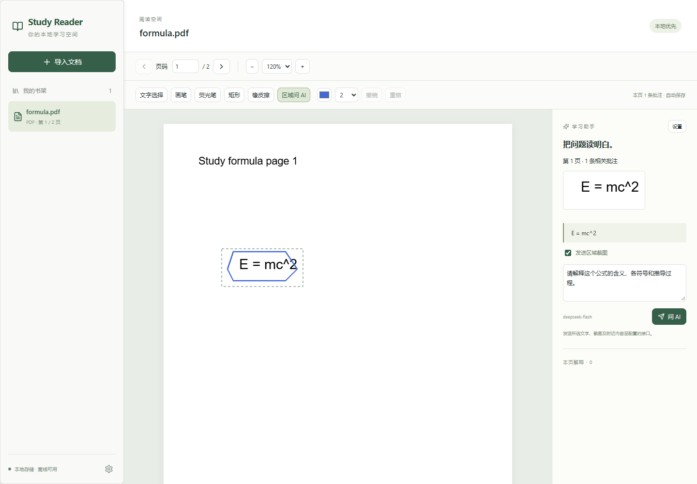

# AI Study Reader

Windows 优先的本地 PDF/TXT 批注阅读器，MIT 开源。Tauri 2 + React + TypeScript，PDF.js 渲染/文本层，原生 Canvas 批注，Rust + SQLite 持久化，Windows Credential Manager 保存 API Key。

**[下载 Windows 安装包](https://github.com/myfines/ai-study-reader/releases/latest) · [测试报告](TEST-RESULTS.md) · [已知问题](KNOWN-ISSUES.md)**

支持自由画笔、荧光笔、矩形、橡皮擦、撤销/重做；批注在缩放、翻页和重启后保持页面坐标。框选公式可提取附近文字与区域截图，发送到用户配置的 AI 接口，并把解释保存到原页。



应用不需要账号或自建服务器。阅读、批注、查看已保存回答均可离线使用。AI 请求需要用户自己的 API Key；第三方接口可能按服务商规则收费，应用没有支付或订阅功能。

## 安装和运行

安装包位于 `release/AI Study Reader_0.1.0_x64-setup.exe`，双击安装。完整源码归档为 `release/AI-Study-Reader-0.1.0-source.zip`，校验文件为 `release/SHA256SUMS.txt`。Windows 10/11 x64 需要 Microsoft Edge WebView2 Runtime。NSIS 安装程序在缺少 WebView2 时会下载微软运行时，首次安装可能需要网络；已有运行时的电脑可离线阅读。

源码开发推荐 Node.js 22.12+（本项目验证使用 Node 24）、Rust stable MSVC、Visual Studio 2022 Build Tools 的“使用 C++ 的桌面开发”及 Windows SDK。官方前置要求：https://v2.tauri.app/start/prerequisites/ 。

```powershell
cd ai-study-reader
npm ci
npm run desktop
```

`npm run dev` 只启动浏览器预览。预览使用 IndexedDB，不能保存 API Key 或调用 AI；桌面版使用真实 SQLite 与系统凭据管理器。两者书架互不共享。

项目内 `.tools/` 如存在，是本次开发使用的局部 Rust GNU 工具链，不改变系统 PATH；不包含在源码发布包中。在本机可运行 `pwsh -File scripts/build-windows.ps1`，脚本会识别局部工具链。GNU 构建自动使用 Rust 自带 LLD，并将含空格路径的编译产物放到 `C:\tmp\ai-study-reader-target`，以绕过旧 MinGW/资源编译器限制。标准开发环境推荐系统 Rust/MSVC。

## 使用

1. 导入 PDF/TXT，应用将文件内容复制到本地数据库，以 SHA-256 去重；导入后移动或删除原文件不影响阅读。
2. 用页码框、前后页按钮和缩放控件阅读。选择“文字选择”时保留 PDF.js 原生文本层，可复制文本。
3. “画笔”画圈或写字；“荧光笔”自由拖动；“矩形”添加矩形批注；“橡皮擦”删除触碰的笔迹对象。撤销/重做支持本页最近 50 步，翻页或重新打开后从已保存批注开始新的撤销历史。
4. 用“区域问 AI”框选公式，右侧会显示原始页面截图、附近文本和相交批注数量。也可选择 PDF/TXT 文字。
5. 在设置中保存接口地址、模型和 Key。默认 `https://api.deepseek.com` / `deepseek-flash`，支持截图。`deepseek-chat` 等纯文字配置绝不发送图片。自定义 OpenAI Chat Completions 兼容视觉接口须填写模型，并明确勾选支持图片；可使用本机 HTTP 接口。
6. 检查上下文并点击“问 AI”。请求在 Rust 中执行，流式显示真实正文。完成、失败或停止后的部分回答均关联文档、页码、区域和批注 ID 保存；点击已有解释可查看上下文并追问。生成中切换页面不会改变回答所属页。

视觉模型能力依据 DeepSeek 官方文档（2026-10-15 检查）：https://api-docs.deepseek.com/guides/vision/ 。非视觉模型只发送文字，界面明确提示限制，不把图片伪装成文本输入。

## 坐标与保存

批注存储于对应 PDF 页面 **PDF.js scale=1 的标准视口坐标**，单位为页面点，原点为页面显示左上角，保留 PDF 自带旋转/CropBox/UserUnit 的映射。显示时乘以缩放，鼠标输入除以缩放；DPI 仅作用于 Canvas 位图，不进入保存坐标。没有把窗口坐标存入数据库，也没有因缩放重新改写笔迹。

文档 BLOB、书架、阅读进度、每页批注 JSON、对话 JSON 和非敏感设置都存入 `%APPDATA%\org.aistudy.reader\reader.sqlite`，采用 SQLite WAL 和参数化查询。备份应在退出应用后复制该目录。Key 只在 Windows 凭据管理器中，按规范化接口地址隔离；界面不回读 Key，只显示是否已保存。切换接口需要为新地址另存 Key。

所有修改串行写入；正常关闭窗口时等待待完成写入。如出现保存失败，显示错误并阻止第一次退出，便于用户处理。应用崩溃或操作系统强制结束时，最后尚未提交的操作仍可能丢失。

发送 AI 时仅提交选择内容、至多 10,000 字附近页面文本、相关批注、可选区域截图及该对话的有限历史。PDF、TXT、回答均不作为可执行 HTML 显示；文档上下文明确标为不可信数据。截取图像仅来自当前本地页面，最长边限制 1600 像素。

## 测试与构建

```powershell
npm test
npm run test:e2e  # 本机 Edge，默认无头
npm run build
cd src-tauri
cargo test --locked
cd ..
npm run bundle
```

安装包默认生成于 `src-tauri/target/release/bundle/nsis/`。安装包未购买商业签名证书。使用 `.github/workflows/windows.yml` 可在 GitHub Windows runner 重跑测试并生成安装包；当前目录应作为独立仓库根目录。

可运行 `pwsh -File scripts/build-windows.ps1 -TestsOnly -NativeAcceptance` 重做浏览器与真实桌面程序验收。原生测试使用临时数据库、短期测试凭据和明确标注的本机 SSE 协议夹具，验证 Rust HTTP 传输与保存链路，结束时删除测试凭据；不会把夹具接入产品功能，也不代表真实模型质量验证。

`scripts/run-log.ps1` 保留完整日志于 `logs/`，并将压缩前内容按 SHA-256 缓存于 `.headroom-cache/`。已运行结果、环境限制和原生验证详情见 [TEST-RESULTS.md](TEST-RESULTS.md)。

## 许可证与已知限制

项目 MIT，第三方许可证见 [THIRD-PARTY-NOTICES.md](THIRD-PARTY-NOTICES.md)、[DEPENDENCY-LICENSES.md](DEPENDENCY-LICENSES.md)、[RUST-LICENSES.md](RUST-LICENSES.md) 和 `licenses/` 中完整 notices。核心依赖使用 MIT、Apache-2.0、ISC/BSD 等允许商业使用的许可证；SQLite public domain。工具链许可证与运行时依赖分别记录。

已知问题和下一阶段建议见 [KNOWN-ISSUES.md](KNOWN-ISSUES.md)。没有模拟 AI 回复；测试中的协议数据是明确标注的测试夹具，未接入产品运行流程。
